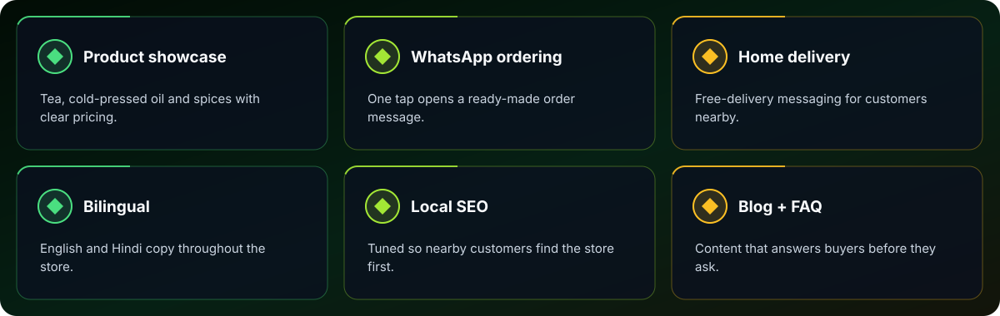
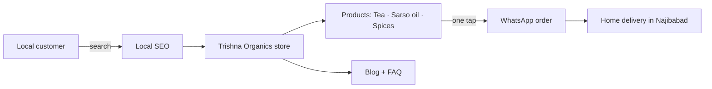

  
  
  
  

  <a href="#-overview"><b>Overview</b></a> &nbsp;•&nbsp;
  <a href="#-features"><b>Features</b></a> &nbsp;•&nbsp;
  <a href="#-tech-stack"><b>Tech</b></a> &nbsp;•&nbsp;
  <a href="#%EF%B8%8F-architecture"><b>Architecture</b></a> &nbsp;•&nbsp;
  <a href="#-source-code"><b>Source</b></a>

## ✨ Overview

**Trishna Organics** ([trishnaorganics.com](https://trishnaorganics.com)) is the online storefront for a local organic brand in Najibabad, Uttar Pradesh: Assam Special Tea, pure cold-pressed Sarso (mustard) oil and hand-picked organic spices.

The site pairs a rich green, editorial look with bilingual (English / Hindi) copy, product cards with pricing, one-tap WhatsApp ordering, free-delivery messaging, a blog and FAQ, and local SEO so nearby customers find it first.

  
   🖥️ Live at <a href="https://trishnaorganics.com"><b>trishnaorganics.com</b></a>

## 🚀 Features

  

| Feature | What it does |
|:--|:--|
| **Product showcase** | Tea, cold-pressed oil and spices with clear pricing. |
| **WhatsApp ordering** | One tap opens a ready-made order message. |
| **Home delivery** | Free-delivery messaging for customers nearby. |
| **Bilingual** | English and Hindi copy throughout the store. |
| **Local SEO** | Tuned so nearby customers find the store first. |
| **Blog + FAQ** | Content that answers buyers before they ask. |

## 🧰 Tech Stack

## 🏗️ Architecture

## 🔒 Source Code

> [!NOTE]
> This is a **showcase repository**. The production source code of **Trishna Organics** is private and is not published here.
> Want a walkthrough, a similar build for your business, or licensing? **[Get in touch →](https://ajendra.info/contact)**

## 👤 Author

**Ajendra** — Full Stack Developer · Security Researcher · AI Engineer · Startup Advisor

⭐ If you like this project, star the repo — and check out my other work on <a href="https://ajendra.info/projects">ajendra.info/projects</a>.

